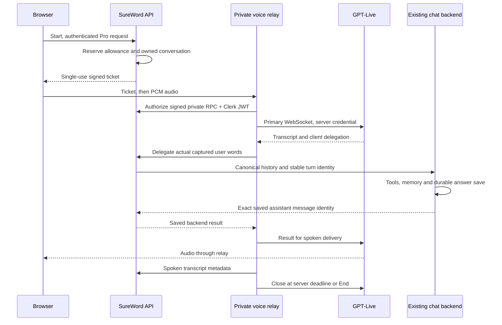

# Account-restricted GPT-Live voice

Live voice is enabled only for Austin's account, whose verified primary
Clerk email is `atmosphere9999@gmail.com`. Other Pro accounts are denied.
The page, availability endpoint, session bootstrap, delegated requests and
transcript RPC all enforce the restriction on the server. A client-supplied
email, an app database email, an unverified address or a secondary address
cannot grant access. Identity-service failures deny access.

Austin approved reusing SureWord's server OpenAI key. The implementation runs
in its own worktree and against a separate Neon branch. It has not been
deployed to production or shipped in native clients. Pro and time limits
remain additional requirements for the allowed account.

## Product contract

- Speech uses the existing `/api/ask-question` backend. Its doctrine, KJV
  foundation, memory, tools, entitlements and message persistence remain the
  authority. The voice model supplies the conversational audio interface.
- User transcripts and canonical answers are ordinary conversation messages.
  Spoken assistant transcripts are retained separately in message metadata,
  because GPT-Live may paraphrase the backend answer. Tool parts remain on the
  canonical answer. The trial links directly to the saved chat.
- Start is explicit. Mute, Stop speaking and End conversation are separate,
  labeled controls. Stop speaking does not undo completed tools. Leaving the
  foreground, navigation, unmount or loss of connectivity releases capture.
- The interface discloses an AI voice. Microphone audio is streamed after
  Start and is not stored by this application. Transcripts and backend results
  are stored. Provider `store: false` does not itself imply zero data retention.

## Allowances and cost

Defaults are **300 seconds per session, 600 per UTC day and 3,600 per UTC
calendar month**, per Pro user, with one active session per user. Daily and
monthly allowances both apply; the next session receives only what remains.
Sessions crossing a UTC reset are shortened at that boundary. Less than 15
seconds remaining cannot start another session.

OpenAI lists GPT-Live at **$0.05 per minute**, billed per second, with backend
model and tool usage charged separately ([official changelog, September 10,
2026](https://developers.openai.com/api/docs/changelog#september-2026)). At the
current rate, the default ceilings are $0.25 per session, $0.50 per day and
$3.00 per month for the voice connection alone. Listening, muted time and
waiting for tools still consume connection time. These limits are initial
trial policy, not a published subscription promise.

The server reserves the full grant transactionally before issuing a
single-use, short-lived ticket. A confirmed provider final usage report can
credit unused seconds. Missing or ambiguous final usage charges the full
reservation, including after a process restart. Client countdowns cannot
extend the server's deadline. End revokes new backend delegations
synchronously; an already-started tool may still complete and save normally.

Optional overrides, in seconds:

| Variable | Default | Maximum |
| --- | ---: | ---: |
| `SUREWORD_LIVE_SESSION_SECONDS` | 300 | 600 |
| `SUREWORD_LIVE_DAILY_SECONDS` | 600 | 1,800 |
| `SUREWORD_LIVE_MONTHLY_SECONDS` | 3,600 | 7,200 |

Invalid settings fail closed. Setting a limit to zero disables grants.

## Transport and persistence



The primary upstream WebSocket belongs to the relay. Terminating it stops the
paid audio transport even if the browser ignores its timer. A browser-owned
WebRTC connection with only a client timer would not provide the same bound.
OpenAI recommends WebRTC for general audio use and supports WebSockets as an
alternative ([transport guidance](https://developers.openai.com/api/docs/guides/live)).
Evaluate WebRTC again for production network quality while retaining an
independent server-enforced cutoff.

Only the relay supplies provider commands. It binds a delegation to captured
human speech, not a model-written task or approval. No OpenAI key or provider
session credential reaches the browser. Private RPC requires both a short
body-bound HMAC signature and the original user's Clerk session identity.
Each delegation rechecks the live ledger, session, Pro entitlement, consent
and conversation ownership after asynchronous authorization.

SQLite uses a private directory, transactions and durable reservations shared
by Next and the relay. Stable turn claims prevent replaying a tool request;
an ambiguous pending request is not automatically retried. Message row locks
merge spoken segments without overwriting canonical text or tool metadata.
Only the exact assistant message returned by the backend stream is accepted
as proof of a saved answer.

## Run locally

Use Node 24.22 or newer and the existing worktree. Install with
`pnpm install --frozen-lockfile`. Keep all secrets in ignored `.env.local`.
The private trial needs the ordinary Clerk, database and backend variables,
plus:

| Variable | Local value or requirement |
| --- | --- |
| `OPENAI_API_KEY` | Existing server key, never a `NEXT_PUBLIC_` variable |
| `SUREWORD_LIVE_ENABLED` | `true` |
| `SUREWORD_LIVE_RELAY_SECRET` | Random secret of at least 32 characters |
| `SUREWORD_LIVE_APP_ORIGIN` | `http://localhost:3144` |
| `SUREWORD_LIVE_RELAY_URL` | `ws://127.0.0.1:3145` |
| `SUREWORD_LIVE_LEDGER_PATH` | Absolute path inside this worktree's `.private/` |
| `SUREWORD_LIVE_ISOLATED_DATABASE_HOST` | Must equal the isolated `DATABASE_URL` hostname |

Run the two processes in separate terminals:

```sh
pnpm exec next dev --hostname localhost --port 3144
pnpm voice:relay
```

Open [Talk to SureWord](http://localhost:3144/voice), sign into the development
Clerk instance with `atmosphere9999@gmail.com`, and accept the normal AI
disclosure. That account must have Pro in the isolated database. Other
accounts get a 404 at the page and a 403 from the availability/session API;
they cannot receive a session ticket. The old `/voice-preview` link redirects
to `/voice` only after the same account check. Use `localhost` for the origin:
this Next/Clerk version normalizes a `127.0.0.1` application host during
authenticated middleware rewrites. The relay itself binds to loopback.

The trial database branch is `sureword-gpt-live-pro-trial` in Neon project
`small-cell-57936982` (branch ID `br-late-water-ak8f2bp6`). No schema migration
is needed. This branch contains a snapshot of existing app data, so treat it
with the same access and retention care. Configuration and QA credentials
must remain ignored. Stop both owned processes to end the local trial; retain
the SQLite ledger across restarts so allowances do not reset. Delete the
trial database branch only after Austin no longer needs its saved test chats.

## Verification and release gates

Run the focused regressions, typecheck, lint and build:

```sh
node --test tests/live-voice-*.test.mjs tests/voice-messages.test.mjs
pnpm typecheck
pnpm lint
pnpm build
```

The tests cover ledger concurrency, quotas and reset boundaries; signed
ticket replay; server cutoff; End during authorization, token refresh or
transcript save; speech association; canonical metadata preservation; final
save failures; bounded HTTP bodies and PCM capture/playback cleanup.

Runtime receipts in ignored `artifacts/live-voice/` distinguish synthetic
speech replay from a physical microphone. The initial real-provider replay
recognized John 3:16, invoked `getPassage`, returned audio, and read back the
canonical KJV answer and spoken transcript from the isolated database. Free
startup returned 403 before creating a conversation; a second concurrent
startup returned 429. A second request in that same session invoked
`findNotes` and `addToNote`; database readback confirmed exactly one new note.
Browser layout was checked at 375 pixels with no horizontal overflow.

The browser's actual capture/worklet/relay/playback path also passed using a
synthetic MediaStream: 227 nonzero PCM packets reached the relay, 660 playback
chunks were scheduled, and the saved KJV transcript appeared in the page.
Mute stopped capture delivery. Explicit End closed both test audio contexts
immediately, disabled session controls while draining, and received confirmed
provider usage instead of charging its full reservation. The Chrome fake-file
microphone fixture initially emitted silence; replacing that fixture with a
synthetic MediaStream established this proof without a physical microphone.

The original focused suite passed **65/65** (55 new trial checks and 10 existing
voice-message checks). Typecheck, lint and the production build passed. The
build was retried after an earlier disk-space failure. The sanitized
[validation receipt](validation-2026-10-29.json) records the observed results.

The subsequent account restriction adds regression checks for another Pro
account, unverified/secondary/aliased email, identity-service failure,
client-supplied email, bootstrap denial before reservation, delegated tools
and signed transcript RPC. The previous receipt is historical; the
[account-access receipt](account-access-2026-10-29.json) records verification
of the stricter policy.

Before a production release:

- Exercise Android first, then native iOS/macOS and web with the same chat
  and tool behavior. This page is a temporary prototype surface only.
- Verify microphone permission, device routing, Bluetooth, speaker echo,
  interruption and recovery on real client paths. Test with TalkBack and
  VoiceOver and a blind participant, including Start, waiting, mute, End,
  allowance exhaustion and returning to saved chat. Screen-reader output can
  currently enter capture; the trial asks users to mute while navigating.
- Verify exact spoken KJV wording, tool confirmations and authorization,
  corrections during a pending action, long pauses and overlapping speech.
  Provider transcript timing is used to group segments; it is not a guarantee
  that the listener heard every delivered audio sample.
- Replace the single-host ledger with a shared durable quota/turn store before
  multi-instance hosting. Next and the relay currently must share the same
  disk. A Vercel-only serverless deployment is not supported by this trial.
- Add account deletion/retention for relay turn records, operational usage
  reconciliation, a global spend circuit breaker and limited rollout controls.
  Per-user time caps are not a cap on total project spend or backend tool cost.

Track client status in [PARITY.md](../PARITY.md). Production, store submission
and blind-user acceptance have not been established by these prototype checks.
